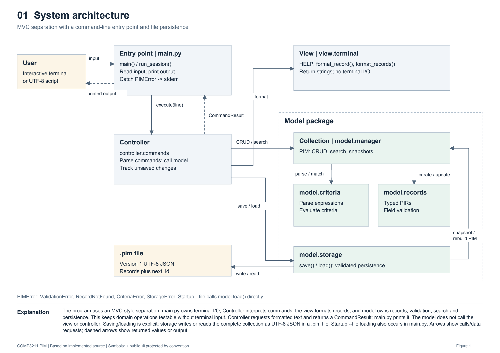
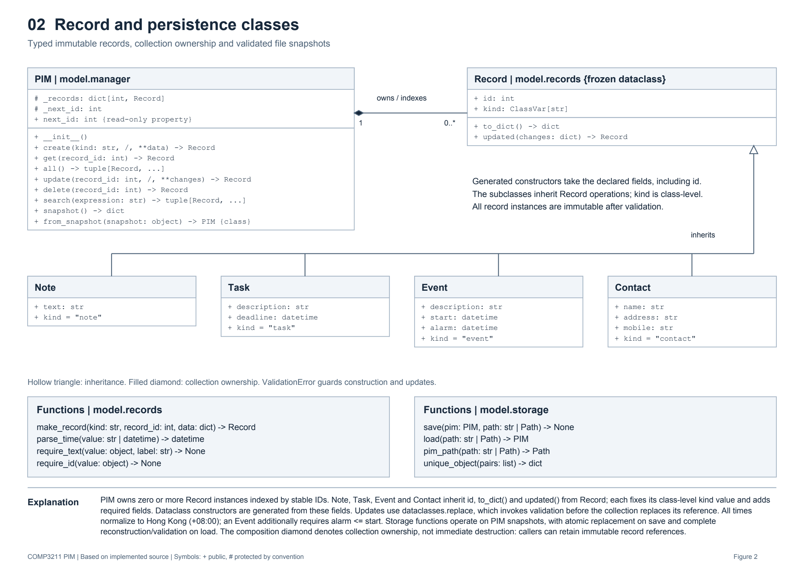
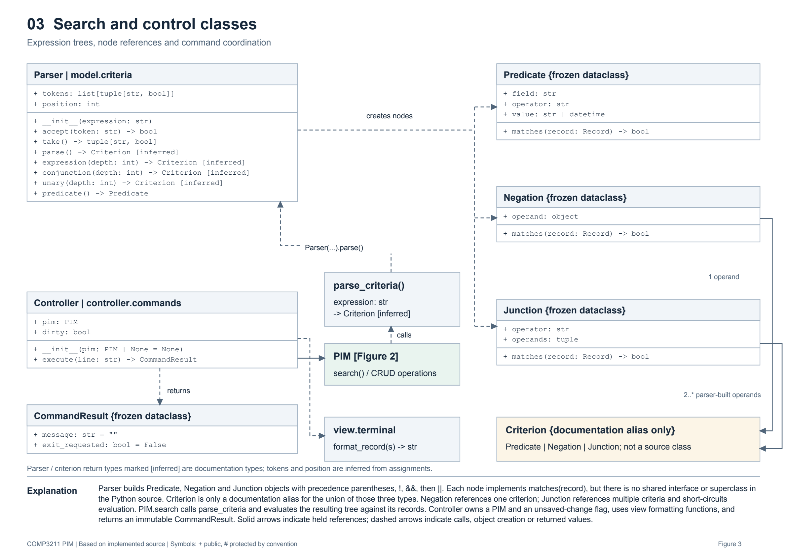
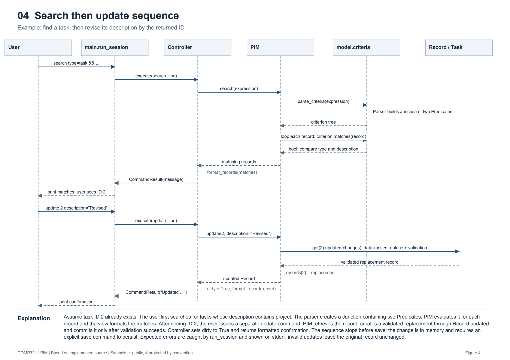

# PIM design explanations

Source baseline: `fcaee3f`. See the PDF appendix for full API and exception details.

## Figure 1 System architecture

The program uses an MVC-style separation: main.py owns terminal I/O, Controller interprets commands, the view formats records, and model owns records, validation, search and persistence. This keeps domain operations testable without terminal input. Controller requests formatted text and returns a CommandResult; main.py prints it. The model does not call the view or controller. Saving/loading is explicit: storage writes or reads the complete collection as UTF-8 JSON in a .pim file. Startup --file loading also occurs in main.py. Arrows show calls/data requests; dashed arrows show returned values or output.

## Figure 2 Record and persistence classes

PIM owns zero or more Record instances indexed by stable IDs. Note, Task, Event and Contact inherit id, to_dict() and updated() from Record; each fixes its class-level kind value and adds required fields. Dataclass constructors are generated from these fields. Updates use dataclasses.replace, which invokes validation before the collection replaces its reference. All times normalize to Hong Kong (+08:00); an Event additionally requires alarm <= start. Storage functions operate on PIM snapshots, with atomic replacement on save and complete reconstruction/validation on load. The composition diamond denotes collection ownership, not immediate destruction: callers can retain immutable record references.

## Figure 3 Search and control classes

Parser builds Predicate, Negation and Junction objects with precedence parentheses, !, &&, then ||. Each node implements matches(record), but there is no shared interface or superclass in the Python source. Criterion is only a documentation alias for the union of those three types. Negation references one criterion; Junction references multiple criteria and short-circuits evaluation. PIM.search calls parse_criteria and evaluates the resulting tree against its records. Controller owns a PIM and an unsaved-change flag, uses view formatting functions, and returns an immutable CommandResult. Solid arrows indicate held references; dashed arrows indicate calls, object creation or returned values.

## Figure 4 Search then update sequence

Assume task ID 2 already exists. The user first searches for tasks whose description contains project. The parser creates a Junction containing two Predicates; PIM evaluates it for each record and the view formats the matches. After seeing ID 2, the user issues a separate update command. PIM retrieves the record, creates a validated replacement through Record.updated, and commits it only after validation succeeds. Controller sets dirty to True and returns formatted confirmation. The sequence stops before save: the change is in memory and requires an explicit save command to persist. Expected errors are caught by run_session and shown on stderr; invalid updates leave the original record unchanged.

